<div align="center">




# `JECIDT SEBASTIÁN` 
### `FULL-STACK DEVELOPER IN TRAINING · THE NIGHT SHIFT`


<p>
  <a href="https://github.com/Jecidt"></a>
  
  
</p>

**Build in silence. Solve real problems. Let the code speak.**

[About me](#-who-is-behind-the-mask) · [Projects](#-classified-project-files) · [Tech](#-the-utility-belt) · [Stats](#-live-gotham-telemetry) · [Contact](#-send-the-signal)

</div>

---

## 🦇 WHO IS BEHIND THE MASK?

I'm a developer in progress who enjoys turning ambitious ideas into practical software. I'm interested in full-stack development, Python, database-backed applications, and interfaces that feel as good to use as they are to look at.

The Batman / Bruce Wayne influence is the *visual and mindset inspiration*: focus, preparation, curiosity, and persistence. The mission here is real-world software—not just a cool-looking screen.

- 🔭 **Building:** full-stack applications and practical learning projects.
- 🌱 **Learning:** Python, software architecture, data modeling, and reliable application behavior.
- 🧠 **Focused on:** connecting user experience, business rules, backend logic, and database persistence.
- 🎯 **My standard:** a feature should work end-to-end, not merely look finished.
- 🌃 **Aesthetic:** Gotham after dark—black, midnight blue, electric blue, and signal gold.

> *A good interface gets attention. Reliable software earns trust.*

## 🎯 THE MISSION

<table>
<tr>
<td width="50%" valign="top">

### 🧩 Think like an engineer
- Understand the problem before coding.
- Turn requirements into observable behavior.
- Keep responsibilities separated.
- Design for errors and edge cases.
- Verify that data persists correctly.

</td>
<td width="50%" valign="top">

### ⚡ Build like a creator
- Make interfaces clear and responsive.
- Learn by shipping practical projects.
- Refine details without losing the goal.
- Document setup and important decisions.
- Improve one release at a time.

</td>
</tr>
</table>

## 🗂️ CLASSIFIED PROJECT FILES

### `01 / AXISFIT — TRAINING MANAGEMENT`

**Mission:** connect training plans, users, instructors, and daily activity in one consistent application.

What I care about building well:
- Role-aware experiences for instructors, apprentices, and employees.
- Routine assignment with clear exercises and schedules.
- Database persistence from creation through display.
- Daily workout information that users can understand quickly.
- Predictable handling of missed sessions and attendance.
- Business rules that stay consistent across the interface and database.

`FOCUS: FULL STACK · DATABASE DESIGN · BUSINESS LOGIC · UX`

### `02 / PYTHON QUEST — LEARN BY PLAYING`

**Mission:** make Python less intimidating for absolute beginners through small challenges, feedback, and progression.

Planned learning levels:
- Variables, data types, and operators.
- Conditions and loops.
- Strings and collections.
- Functions and scope.
- Exceptions, files, and modules.
- Object-oriented programming.
- Testing, debugging, and a final project.

`FOCUS: PYTHON · EDUCATION · GAME DESIGN · PROBLEM SOLVING`

### `03 / GOTHAM LAB — EXPERIMENTS`

A workshop for prototypes, small utilities, interface ideas, automation, and experiments that help me learn by doing.

Every experiment should answer four questions:
1. What problem does it solve?
2. What is the smallest useful version?
3. How will I test that it works?
4. What is the next improvement?

`FOCUS: PROTOTYPING · CONTINUOUS LEARNING · CREATIVE ENGINEERING`

> These project summaries describe my focus and goals. I only mark a project as completed when the repository and working implementation support that claim.

## 🧰 THE UTILITY BELT

<div align="center">

### Languages & web foundations


### My engineering priorities


</div>

I keep this list as a snapshot of tools and topics I am exploring—not a claim that I have mastered every item. Skill is built through practice, feedback, and projects that work.

## 🛰️ LIVE GOTHAM TELEMETRY

<div align="center">


</div>

<sub>Stats are loaded from external services and may take time to appear. Your GitHub username is `Jecidt`.</sub>

## 🐍 CONTRIBUTION SNAKE

<div align="center">

</div>

To enable it, configure `.github/workflows/snake.yml` using the instructions in `docs/ENABLE-SNAKE.md`. The rest of the profile works without it.

## 🖥️ GOTHAM STATUS

```text
┌────────────────────────────────────────────────────────────────┐
│  OPERATOR       JECIDT                         STATUS: LEARNING │
├────────────────────────────────────────────────────────────────┤
│  MAIN OBJECTIVE Build software that solves real problems       │
│  CURRENT PATH   Full Stack + Python + Database-backed apps     │
│  SPECIAL SKILL  Turning vague ideas into clear requirements    │
│  SIDE QUEST     Make learning feel like an adventure           │
│  CURRENT BOSS   Complexity                                    │
│  COUNTER-MOVE   Break it down. Build it. Test it. Improve it.   │
└────────────────────────────────────────────────────────────────┘
```

## 🧭 THE ROADMAP

- [ ] Build more end-to-end applications with persistent data.
- [ ] Strengthen Python fundamentals through practical projects.
- [ ] Add automated tests for important business rules.
- [ ] Improve database modeling and query design.
- [ ] Make interfaces responsive and accessible.
- [ ] Improve documentation, setup instructions, and release quality.
- [ ] Share projects with clear demos and honest descriptions.

## 🔍 HOW I DEBUG

1. **Reproduce** the problem reliably.
2. **Observe** the exact input, output, and error.
3. **Trace** the data from the UI to the backend and database.
4. **Isolate** the smallest part that causes the behavior.
5. **Fix** the cause, not just the visible symptom.
6. **Test** the normal case and likely failure cases.
7. **Document** the lesson so the same issue is easier next time.

## 🧪 MY DEFINITION OF “DONE”

- [ ] The feature meets its requirement.
- [ ] Data remains correct after refreshing the page.
- [ ] Permissions are enforced by the application, not just hidden buttons.
- [ ] Empty, loading, success, and error states are handled.
- [ ] Invalid input produces useful feedback.
- [ ] The layout works on desktop and mobile.
- [ ] Another developer can run the project from the documentation.
- [ ] No passwords, API keys, or private data are committed.

## 🧠 THE CODE PHILOSOPHY

```python
def build_something_useful(problem):
    requirements = understand(problem)
    plan = break_into_small_steps(requirements)
    solution = implement(plan)
    verify(solution)
    improve(solution)
    return solution
```

**Curiosity starts the mission. Discipline keeps it moving. Testing confirms the result.**

## 🤝 COLLABORATION PROTOCOL

I appreciate people who are curious, direct, and willing to make an idea better.

- Share the problem you are trying to solve.
- Include steps to reproduce a bug when possible.
- Explain important constraints early.
- Give constructive feedback and stay open to alternatives.
- Celebrate progress while staying honest about what still needs work.

## 📡 SEND THE SIGNAL

<div align="center">

<a href="https://github.com/Jecidt"></a>
<a href="mailto:TU-CORREO@EJEMPLO.COM"></a>

<br/>


### `END OF TRANSMISSION // GOTHAM OUT`

**Thanks for stopping by. Keep building. Keep learning.**

<sub>Original Gotham-inspired visual identity · Built for a GitHub profile README</sub>

</div>
