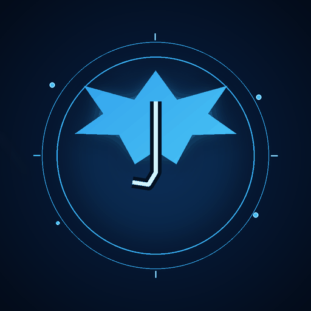

# JECIDT · ARCHIVO GOTHAM

### Aprender con intención. Construir con criterio. Mejorar sin pausa.

## 🦇 01 / Quién está detrás de la máscara

Soy **Jecidt**. Estoy construyendo mi camino en el desarrollo de software a través de proyectos, práctica y resolución de problemas reales. Me interesa entender cómo encajan las piezas: una interfaz clara, una lógica coherente, una base de datos bien diseñada y una experiencia que de verdad le sirva a alguien.

No estoy aquí para aparentar que lo sé todo. Estoy aquí para **aprender, experimentar, corregir y convertir ideas en soluciones funcionales**. La estética de Gotham representa mi forma favorita de trabajar: enfoque, estrategia, curiosidad y atención al detalle.

## 🧭 02 / Mi forma de trabajar

<table>
  <tr>
    <td width="50%" valign="top"><strong>🧩 Resolver antes que adornar</strong> Entender el problema y sus reglas antes de diseñar la solución.</td>
    <td width="50%" valign="top"><strong>🗃️ Datos con sentido</strong> Alinear las funciones, las relaciones de datos y las reglas del sistema.</td>
  </tr>
  <tr>
    <td width="50%" valign="top"><strong>🧱 Código organizado</strong> Separar responsabilidades, mantener nombres claros y evitar mezclar todo en un mismo archivo.</td>
    <td width="50%" valign="top"><strong>🔍 Probar y corregir</strong> Una pantalla bonita no basta: importan la persistencia, los casos límite y el uso real.</td>
  </tr>
</table>

## 💻 03 / Tecnologías que estoy explorando

> Estas etiquetas indican áreas de práctica y aprendizaje; no pretenden afirmar un nivel experto.

Mi objetivo no es coleccionar tecnologías: es aprender a utilizarlas con criterio, documentar lo que construyo y entender por qué funciona.

## 🧪 04 / Proyectos y misiones

<table>
  <tr>
    <td width="50%" valign="top">
      <h3>🧰 Laboratorio web — repositorio público</h3>
      
Un espacio de trabajo con Next.js, React, TypeScript, Tailwind CSS y herramientas de datos. Consulta el repositorio para ver el código y su estado más reciente.

      
<code>NEXT.JS</code> <code>REACT</code> <code>TYPESCRIPT</code>

      <a href="https://github.com/Jecidt/proyectos"><strong>Ver repositorio →</strong></a>
    </td>
    <td width="50%" valign="top">
      <h3>⚙️ AxisFit / Agrofit</h3>
      
Una línea de trabajo enfocada en la gestión del entrenamiento: usuarios, rutinas, asignaciones y seguimiento. El reto es alinear reglas de negocio, interfaz y base de datos.

      
<code>FULL-STACK</code> <code>BASE DE DATOS</code> <code>REGLAS DE NEGOCIO</code>

      <strong>Estado:</strong> en construcción / evolución.
    </td>
  </tr>
  <tr>
    <td width="50%" valign="top">
      <h3>🐍 Python Quest</h3>
      
Concepto de recorrido educativo para aprender Python desde cero mediante explicaciones, retos, práctica guiada y pequeños logros.

      
<code>PYTHON</code> <code>APRENDIZAJE</code> <code>JUEGO EDUCATIVO</code>

      <strong>Estado:</strong> idea en exploración.
    </td>
    <td width="50%" valign="top">
      <h3>🌃 Gotham Lab</h3>
      
Un nombre para mis experimentos visuales, pequeñas herramientas, pruebas de interfaz y nuevas ideas que puedan crecer hasta convertirse en proyectos.

      
<code>PROTOTIPOS</code> <code>EXPERIMENTACIÓN</code>

      <strong>Estado:</strong> laboratorio personal.
    </td>
  </tr>
</table>

> **Transparencia:** distingo entre repositorios públicos e ideas en desarrollo. Solo enlazo proyectos publicados cuando existe una dirección real; los estados se actualizan conforme avance el trabajo.

## 📈 05 / Actividad y constancia

La actividad se representa con mis contribuciones reales de GitHub. La serpiente se genera automáticamente con GitHub Actions; **la primera vez hay que habilitar los permisos y ejecutar el flujo manualmente**. Sigue [`docs/INSTALACION.md`](./docs/INSTALACION.md) para activarla.

[Ver actividad real en GitHub](https://github.com/Jecidt?tab=overview)

No incluyo cifras de commits, seguidores o lenguajes escritas a mano: prefiero mostrar datos reales y evitar paneles externos que fallen o den una impresión engañosa.

## 🎯 06 / En qué quiero mejorar

- Diseñar aplicaciones completas, desde la interfaz hasta la persistencia de datos.
- Fortalecer la lógica de programación y resolver problemas paso a paso.
- Escribir código más claro, organizado, comprobable y mantenible.
- Construir proyectos que respondan a necesidades reales y estén bien documentados.

## 🛡️ 07 / Código personal

> **La disciplina vence a la improvisación.**
>
> Cada error deja una pista. Cada proyecto enseña algo. Cada mejora cuenta.

**Gracias por entrar al Archivo Gotham.**

Identidad visual original · Código, curiosidad y mejora continua.

